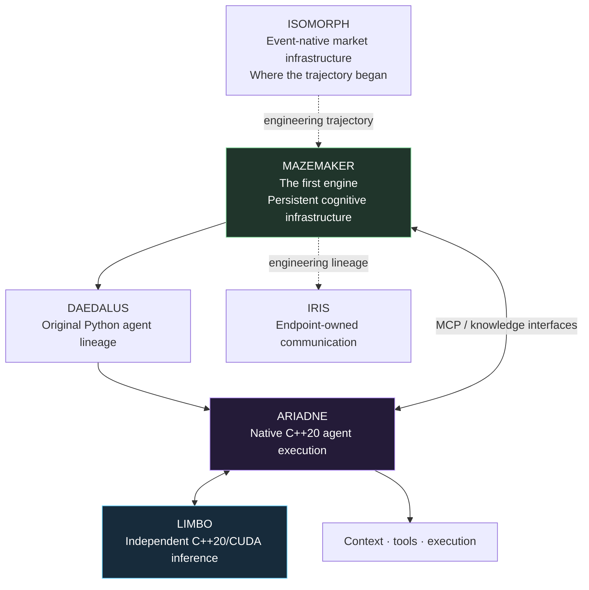
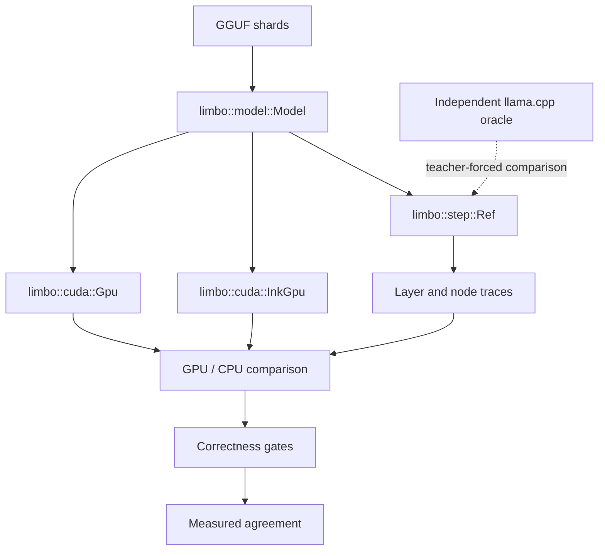

# LIMBO

**BY ITERFORM**

### Native inference infrastructure. Architected from the Maze. Serving its evolution.

---

**One model reader. One arithmetic contract. Every optimization earns its place.**

Limbo is an independent C++20/CUDA inference engine, built from scratch to take control of model execution on constrained hardware.

It owns the complete inference path: model loading, tensor validation, quantized computation, CPU/GPU execution, memory placement, attention state, speculative decoding and model serving.

No embedded inference framework. No Python in the inference path. No external engine performing the forward pass.

But Limbo did not emerge in isolation.

It belongs to a systems lineage whose first engine is **MazeMaker**: built around persistent knowledge formation, evolving cognitive structure and continuity beyond individual conversations.

MazeMaker established the foundation. Building on it exposed further problems that deserved independent solutions: how an agent should execute, how its inference should be controlled, how communication should preserve endpoint ownership, and how complex event-driven systems should keep their own source of truth.

The agent lineage evolved from Daedalus into **Ariadne**, a native C++20 execution harness. Limbo emerged as the independent inference engine for that local execution environment.

- **MazeMaker** forms and preserves knowledge.
- **Ariadne** turns knowledge and context into sustained agent execution.
- **Limbo** executes the underlying models, with explicit control over computation and memory.

They are independent systems with explicit integration boundaries, not modules of one monolithic application.

> **The maze came first. The thread came next. The engine followed.**

[](https://en.cppreference.com/)
[](https://developer.nvidia.com/cuda-toolkit)
[](https://www.gnu.org/software/make/)
[](scripts/readme_claims.py)
[](THIRD_PARTY_NOTICES)

### At a glance

| | |
|---|---|
| Engine | C++20/CUDA from scratch: one GGUF reader, a CPU reference, GPU kernels, an OpenAI-compatible server |
| Start | `limbo -hf agentionai/Signal-3.8-27B-GGUF:IQ3_S` (finds or fetches the file, then fits itself to the card) |
| Runs on the GPU | Qwen3.6-35B-A3B, Qwen3.8-27B and Signal-3.8-27B, Qwen3.8-Flash-Next, Inkling-2-Mini |
| Fits itself | drafter, K/V format, context up to 262,144 positions, checkpoints and slots, planned from free VRAM at open |
| Speculation | MTP, n-gram, DFlash2 and DSpark drafts; greedy output identical to the plain loop |
| Proof | CPU reference against a llama.cpp oracle, GPU against the CPU, every number below gated to its artifact |

---

## 01 — The first engine: MazeMaker

Before Limbo, before Ariadne, there was MazeMaker.

Not a vector database with a conversation-history wrapper. Not a retrieval plugin. A cognitive infrastructure built around the idea that persistent intelligence requires more than storing text and retrieving similar fragments.

MazeMaker introduced the foundational engineering problem: knowledge must evolve.

Memories become connected structures. Relationships accumulate evidence. Contradictory information can supersede stale information. Background consolidation discovers connections that individual conversations never explicitly established.

Its architecture turns conversations into a persistent, evolving knowledge graph through:

- Atomic fact extraction.
- Semantic and graph-based relationships.
- Spreading activation and associative recall.
- Conflict detection and supersession.
- NREM and REM consolidation.
- Insight formation and synthesis.
- Cross-session continuity.
- Explainable retrieval with activation traces.

Its central distinction:

**Memory is not retrieval. Memory is formation, consolidation, synthesis and evolving structure.**

### The thread out of the maze

Ariadne is not an arbitrary product alongside MazeMaker. The naming is deliberate.

MazeMaker provides the evolving knowledge structure. Ariadne provides the agent execution system that navigates work, tools, context and accumulated knowledge.

Daedalus was the Python agent implementation. Ariadne took that lineage into native C++20, with its own execution loop, context tape, managed epochs, tool registry, inference transport and knowledge routing.

Limbo answers another responsibility that development revealed: inference itself should be independently controllable.

An agent should not have to surrender its entire computational foundation to an opaque third-party runtime. It should be possible to own the execution path too.

### The architecture that emerged



This is a lineage diagram, not a dependency diagram.

ISOMORPH is where the engineering trajectory began. MazeMaker is the first engine of the agent lineage. Ariadne integrates with its knowledge infrastructure; Limbo integrates with Ariadne through inference interfaces. Iris is an independent development on the same trajectory.

Limbo does not require MazeMaker to run. MazeMaker does not require Limbo to preserve or consolidate knowledge.

**The systems are independent precisely because their responsibilities are explicit.**

---

## 02 — The problem Limbo solves

Limbo is engineered around one deliberately constrained machine class.

| Component | Target |
|---|---|
| GPU | NVIDIA RTX 4060 Ti, 16 GB VRAM |
| Interface | PCIe Gen3 x8 |
| CPU | AMD Ryzen 7 3800X, 8 cores / 16 threads, AVX2 |
| System RAM | 31 GB |

This is not an attempt to reproduce a datacenter inference stack on a desktop.

It is an attempt to extract the most useful inference from hardware that cannot keep every model weight, every context position and every execution buffer in GPU memory — on a card that also drives the desktop.

The target workloads:

- Dense models that fit in VRAM but leave little room for context and a drafter.
- MoE models whose complete weights cannot reside in VRAM.
- Long-context inference reaching 262,144 positions.
- Several agent conversations sharing one memory pool.
- Speculative decoding without changing accepted greedy output.
- Real tool-using agent workloads with large system prompts and persistent conversation state.

The governing principle:

> **Every byte has a home. Every transfer has a cost. Every placement is a decision.**

Non-resident weights and cache pages are computed where they live or moved where they are needed, whichever is cheaper. VRAM, pinned host memory and PCIe bandwidth are one placement problem, planned once at open from the memory that is actually free.

---

## 03 — What runs today

Limbo implements architecture-specific execution paths over one model reader.

| Architecture | Models | CPU reference | GPU execution | Serving |
|---|---|---|---|---|
| `qwen35moe` | Qwen3.6-35B-A3B | `Ref` | `Gpu`: graph decode, batched int8 prefill, MTP, DFlash2, verify windows | CPU / GPU |
| `qwen35` | Qwen3.8-27B, Signal-3.8-27B | `Ref` | `Gpu`: int8 decode and verify windows, pipelined int8 prefill, MTP, DFlash2 | CPU / GPU |
| `qwen4exp` | Qwen3.8-Flash-Next | `Ref` | `Gpu` with a CPU lane: experts across VRAM and pinned RAM, layer-major prompt pass, sparse attention on the device | CPU / GPU |
| `gemma4` | Gemma 4 (tokenizer and test model) | `Ref` | — | CPU |
| `inkling2_loop` | Inkling-2-Mini | `Ref` | `InkGpu`: the whole token on the device, DSpark drafts | GPU |

These are architecture-specific implementations, not a blanket claim that every model works on every device.

### Quantized execution

The GPU has native kernels for the GGUF block layouts of the supported model ladder:

- F32, F16, BF16
- Q8_0
- Q2_0
- Q2_K through Q6_K
- IQ1_S, IQ1_M
- IQ2_XXS, IQ2_XS, IQ2_S
- IQ3_XXS, IQ3_S
- IQ4_XS, IQ4_NL
- NVFP4

Each format has its own block-layout-aware implementation. The CPU decoders are byte-identical to ggml's `to_float` on every validated format.

Twelve of them (Q2_K through Q6_K, Q8_0, IQ2_XXS, IQ2_XS, IQ2_S, IQ3_XXS, IQ3_S, IQ4_XS) also decode straight into int8 tensor-core fragments: one read of a weight serves a decode step, every row of a verify window, or a prefill tile.

Quantization is part of the computational implementation, not an input-file convenience.

### CPU/GPU cooperation

Models do not have to fit entirely in VRAM.

The `qwen4exp` path runs a CPU lane for the experts that do not fit: they are evaluated from pinned host memory during the same decode step, under the same placement plan. This is workload placement, not an all-or-nothing offload switch.

### Inkling-2

`limbo::cuda::InkGpu` is a dedicated execution path for the `inkling2_loop` architecture. It executes the complete 36-visit graph as one fixed device launch sequence per token:

- Relative-bias attention.
- Short convolutions.
- Loop control.
- SiTU MoE.
- Depth mixing.
- Visit-slot output handling.

The device path is validated against the CPU reference on the actual model, and `limbo_serve_gpu` serves it with Inkling's own DSpark drafter.

---

## 04 — One computational contract

Limbo has independently executable implementations and a separate external measurement oracle.

The model reader establishes the file geometry. The CPU reference is the comparison baseline. GPU execution is tested against that reference. The CPU implementation is compared against the operator's llama.cpp oracle.



### The file is the model

GGUF shards are memory-mapped and validated tensor by tensor: type, byte count, shape, architecture-specific geometry and the expected tensor map. An unclaimed tensor is an error.

Layer counts, heads, expert geometry, sliding-window patterns and architecture-specific structures are asserted from the tensors themselves rather than trusted from configuration metadata.

### Fixed-order reductions

A result must not depend on launch geometry. Reductions run in a fixed order wherever the arithmetic contract needs it, split-K partials included.

The int8 kernels choose their path by weight format, matrix width and stream, never by the number of rows. A decode step and a verify window therefore compute a row with the same bits, which is what lets speculation keep the plain loop's text.

### The external oracle

Comparisons against the operator's llama.cpp build are teacher-forced and position by position.

The oracle is a measurement instrument, not a runtime dependency. Limbo's oracle utilities link against that build; the inference engine itself does not link or embed llama.cpp.

The external implementation challenges Limbo without becoming part of its execution path.

---

## 05 — Memory is part of execution

### Paged K/V

One pool of 256-position pages serves all conversation slots:

- Page tables and reference counting.
- Copy-on-write.
- Prefix adoption by reference.
- Shared prefix storage.
- Independent conversation state.
- Recurrent-state checkpoints.
- Restore on prompt divergence.

| Format | Characteristics |
|---|---|
| F16 | Exact reference representation |
| Q8 | Q8_0 numerics, about half the storage |
| Q4 | Q4_0 numerics with rotated keys, 28% of F16 |

`--kv auto` takes the most exact format whose allocation covers the requested configuration. Decode attention over Q8 and Q4 pages runs on the tensor cores.

### Conversation state

A slot is one conversation, not one model. Several conversations share a pool without merging their logical state.

This matters for agent execution: Ariadne keeps a main agent and a prewarming sidekick over shared prefixes without copying whole prompt histories into separate pools.

Ariadne owns the meaning and lifecycle of its context. Limbo owns the computational K/V representation required to process it.

### Long context

GPU configurations reach 262,144 positions. The real budget depends on architecture, K/V format, resident weights, speculative state, checkpoints and free memory.

The objective is not a context number detached from its memory cost. It is a context budget that can be calculated, inspected and measured.

---

## 06 — Speculative decoding

Limbo drafts from four sources:

- The model's own MTP block.
- N-gram matches from the conversation tape.
- DFlash2 block drafting for the Qwen models.
- DSpark for Inkling-2.

The server picks a source per cycle by expected tokens per millisecond, from window costs it measures. Drafts are verified in a single window of at most eight rows. Only the accepted prefix is committed; when speculation does not pay for itself, execution falls back to ordinary rows.

For greedy decoding, accepted output is identical to the plain loop.

DFlash2 drafters stay in their GGUF formats on the card, the file's bytes rather than a Q8_0 repack (the repack of the 27B's drafter never fit beside the model). `-hf` takes the largest of the Q6_K, Q4_K_M and Q2_K drafters that fits.

### Why this matters for agent workloads

Agent conversations repeat themselves: system instructions, tool schemas, quoted code, file excerpts. N-gram drafts exploit that without a second model.

A prompt that repeats a block of 1,200 tokens (Qwen3.6-35B-A3B, q8 K/V):

| Mode | Throughput |
|---|---:|
| Plain decode | 92.4 tok/s |
| MTP | 133.2 tok/s |
| N-gram | 262.9 tok/s |
| Auto (per cycle) | 267.4 tok/s |

These are workload-specific measurements, not general guarantees. The target model's accepted greedy output is unchanged.

---

## 07 — Ariadne and the local inference stack

Ariadne is the native C++20 agent harness in the MazeMaker lineage. It owns agent execution, context engineering, tool orchestration, knowledge routing and the operator interface.

Limbo owns inference. This is a deliberate separation of concerns.

### Native integration

Ariadne's `limbo` profile launches:

```bash
limbo_serve_gpu -m <model> --host 127.0.0.1 --port 8080 --ctx 65536 --slots 2 --kv auto --spec auto \
    --temperature 1.0 --top-k 20 --top-p 0.95 --min-p 0
```

Two conversation slots share one paged K/V pool: slot 1 the main agent, slot 0 the prewarming sidekick.

The integration uses:

- OpenAI-compatible chat completions.
- Prefix reuse across turns.
- Slot selection through `id_slot`.
- `/props` and `/slots` runtime inspection.
- Explicit slot erasure (`POST /slots/N?action=erase`).
- Speculative decoding.
- Long-context K/V management.

Ariadne owns the execution tape. Limbo owns the inference state.

Ariadne's context engine keeps stable serialized prefixes and rebases working context at configured watermarks; Limbo reuses the cached prompt prefix instead of recomputing it. Each system optimizes its own responsibility without sharing internal implementations.

### MazeMaker remains the foundation

MazeMaker makes experience persistent and structured. Ariadne retrieves relevant knowledge, operates on it, manages working context and coordinates tools. Limbo computes the model's forward pass over the context Ariadne provides.

```text
MAZEMAKER
  persistent knowledge, graph and consolidation
       |
       | MCP / knowledge routing
       v
ARIADNE
  agent execution, context, tools and task lifecycle
       |
       | OpenAI-compatible inference interface
       v
LIMBO
  model execution, CUDA, CPU lanes, K/V and speculation
```

This is a functional integration path, not a requirement that all three run on one machine. MazeMaker can serve many agents. Ariadne can use other inference backends. Limbo can serve clients other than Ariadne.

**The origin is shared. The implementations and responsibilities remain independent.**

---

## 08 — Performance on the target machine

Measured on **RTX 4060 Ti 16 GB · Ryzen 7 3800X · PCIe Gen3 x8**, the card that also drives the desktop.

### Against llama.cpp

Qwen3.6-35B-A3B UD-IQ3_XXS (rung 1) re-measured on 2026-11-26 with the commands of the 2026-11-19 comparison; `llama-bench` from that run, same machine. Inkling-2-Mini from 2026-11-24.

| Workload | Limbo | llama.cpp |
|---|---:|---:|
| A3B decode, tg128 | 88.4 tok/s | 75.99 ± 1.22 tok/s |
| A3B prefill, 512 tokens, exact | 2,323 tok/s | 2,260.98 ± 78.28 tok/s |
| A3B prefill, 2,048 tokens, exact | 2,471 tok/s | 2,078.44 ± 134.32 tok/s |
| Inkling-2-Mini decode, n_ctx 512 | 50.0 tok/s | 46.19 tok/s |

Exact prefill at 512 tokens is inside llama.cpp's own spread; at 2,048 tokens it is 19% ahead.

### Dense 27B

Signal-3.8-27B AP-IQ3_S through `limbo -hf`, 2026-11-26, against the earlier log of the same model:

| Workload | Before | Now |
|---|---:|---:|
| Prefill, 21,253-token code prompt | 280 tok/s | 554 tok/s |
| Decode after that prompt | 19.7 tok/s | 49.9 tok/s |
| Prefill, 1,024 tokens | 329 tok/s | 666 tok/s |
| Verifying 8 drafts at 32,768 positions | 90.2 ms | 75.8 ms |
| Decode, code prompt, 2,741 MiB above the reserve (ngram + DFlash2) | | 46.2 tok/s |
| Decode, code prompt, 2,493 MiB above the reserve (Q2_K drafter + MTP + ngram) | | 37.6 tok/s |

The IQ3_XXS Qwen3.8-27B: prefill 613 tok/s at 1,024 tokens, decode 37.5 tok/s. With speculation on the code prompt, A3B serves 172 tok/s (152 tok/s on the FP32 kernels) and Inkling-2-Mini 62.7 tok/s.

### Long context and agents

| Workload (A3B, `--ctx 262144`, q4 K/V, 2026-11-21) | Result |
|---|---|
| 222,811-token prompt | 364 s prefill (612 tok/s) |
| Decode after it | 51.8 tok/s |
| Cached follow-up turn | 0.52 s |

Benchmark artifacts:

- [Rung 1 recheck](bench/rung1-recheck-2026-11-26.md)
- [Dense 27B and the int8 decode path](bench/dense27b-2026-11-26.md)
- [GPU performance, 2026-11-19](bench/w1-gpu-perf-2026-11-19.md)
- [Speculative decoding](bench/ngram-2026-11-22.md)
- [Long context](bench/long-context-2026-11-21.md)
- [Inkling-2 decode](bench/inkling2-decode-tune-2026-11-24.md)
- [Inkling-2 memory account](bench/inkling2-budget-2026-11-23.md)

These are measurements from named artifacts, not hardware-independent guarantees.

### Known limitations

- Plain decode without speculation is 7% slower on the int8 kernels than on the FP32 kernels (rung 1: 94.8 tok/s with `LIMBO_FRAG=0`). Steps stay on the int8 kernels so that steps and verify windows compute the same bits.
- On the dense 27B the drafter depends on what the desktop leaves free; the smaller fit above costs 19% of decode speed.
- Decode throughput decreases with context as global-layer K/V traffic grows.
- Qwen3.8-Flash-Next stays on the FP32 decode kernels (the int8 path made its steps slower), and its prompt pass streams every non-resident expert over PCIe once per piece.
- Inkling-2 is served with one conversation slot and no recurrent-state checkpoints.
- Gemma 4 is CPU-only and not a performance target.
- CUDA currently targets `sm_89`.
- Throughput measurements are single-run results and are not machine-gated.

Correctness gates establish agreement within explicitly defined comparisons. They do not certify throughput.

**Performance is measured, not advertised.**

---

## 09 — Validation

`make test` runs the registered suites; CUDA tests skip cleanly when the GPU or the model file is missing. On 2026-11-26 it ran 28 of 28 green.

| Gate | Current result |
|---|---|
| GGUF reader and model map | Tensor-by-tensor validation |
| Tokenizer vs `llama-tokenize` | 20/20 files identical |
| Quantization parity | 13/13 formats, 0 differences |
| CPU step vs llama.cpp oracle | 49/50 positions agree |
| Chat template vs Jinja2 | 32 fixtures, 76 interpreter cases |
| CUDA kernel battery | 17 tests green |
| CUDA GEMV vs CPU | Within 1e-5 of row sum |
| CUDA GEMM vs GEMV | Bit-identical |
| Prefill kernels vs saved logits | 0 of 248320 logits differ |
| Decode step vs every verify window size | The same bits |
| Inkling-2 CPU vs oracle | 61/64 positions |
| Inkling-2 GPU vs CPU | 32/32 greedy tokens |
| Inkling-2 deterministic reruns | bit-identical reruns |
| Inkling-2 MoE | Within 2e-6 |
| Inkling-2 memory accounting | 192.0 vs 191.9 KiB/position (predicted vs measured) |

Oracle differences are documented. The K/V and prefill representations have distinct numerical properties; they are not presented as universally bit-identical.

The objective is to expose differences, set explicit acceptance boundaries and make sure an optimization never silently changes execution semantics.

---

## 10 — Build and run

### Requirements

- Linux.
- C++20 compiler (`g++` or Clang) and GNU Make.
- CUDA Toolkit and `nvcc` for GPU execution.
- A quantized GGUF of a supported architecture.
- Optional: Python's `huggingface_hub` for `-hf` downloads; a local llama.cpp build for the oracle and parity tools.

The CPU reference and its tools build without CUDA.

### Build

```bash
make -j6 tools     # engine, servers and tools
make test          # every registered suite
make install       # ~/.local/bin/limbo -> this checkout's limbo_serve_gpu
```

Additional targets: `make oracle` builds the measurement tools against the operator's llama.cpp installation, `make parity` the quantization decoder comparison, `make probe` the hardware probe. `make BUILD=build-experiment -j6 tools` keeps a separate build directory.

### Start a model

```bash
limbo -hf agentionai/Signal-3.8-27B-GGUF:IQ3_S
```

`-hf org/repo[:QUANT]` looks in `LIMBO_MODEL_DIRS` (default `~/models`) and the Hugging Face cache first and downloads only what is missing, the matching drafter from the zoo included. Limbo then plans the fit from the free VRAM: drafter, K/V format, context, MTP block, slots and checkpoints. The scripts in `scripts/serve/` start each measured model; `models.json` records how each one fits and what it measured.

With explicit settings:

```bash
build/bin/tools/limbo_serve_gpu -m /models/model.gguf --ctx 131072 --slots 2 --kv auto --spec auto -v
```

### OpenAI-compatible request

```bash
curl -s http://127.0.0.1:8080/v1/chat/completions \
    -H 'Content-Type: application/json' \
    -d '{"model": "limbo", "messages": [{"role": "user", "content": "Explain your execution architecture."}], "max_tokens": 128}'
```

### CPU reference server

```bash
build/bin/tools/limbo_serve -m /models/model.gguf --ctx 4096
```

Both servers expose the same HTTP interface while executing different implementations.

---

## 11 — Runtime controls

| Flag | Default | Purpose |
|---|---|---|
| `-m FILE`, `-hf org/repo[:QUANT]` | required | GGUF model, by path or by Hugging Face name |
| `--host` | `127.0.0.1` | Bind address |
| `--port` | `8080` | HTTP port |
| `--ctx N\|auto\|max` | `auto` | Context positions, up to 262144; auto is 65536 on the GPU (or the model's own length), 4096 on the CPU; max fits Inkling-2 to the card |
| `--kv auto\|f16\|q8\|q4` | `auto` | K/V representation |
| `--prefill-planes 1\|2\|3` | `2` | Prefill arithmetic |
| `--spec auto\|mtp\|ngram\|dflash\|dspark\|off` | `auto` | Speculative decoding |
| `--draft-model FILE` | the zoo's, with `-hf` | DFlash2 or DSpark drafter |
| `--draft-quant auto\|native\|q8\|bf16` | `auto` | Drafter matrices on the card (auto: native for GGUF) |
| `--slots N` | `1` | Concurrent conversations |
| `--checkpoints N` | `8` | Recurrent-state snapshots |
| `--min-free-gb G` | weights + 1 GiB | Minimum free GPU memory |
| `--vram-reserve-mib M` | `256` | Memory left free for the desktop |
| `--threads N` | `6` | CPU threads |
| `--temperature`, `--top-k`, `--top-p`, `--min-p` | 1.0, off, 1.0, 0 | Sampling for requests that set none |
| `--api-key KEY` | off | Bearer authentication |
| `-v`, `-vv` | off | Runtime event logging |

### Prefill arithmetic

The prefill planes are explicit numerical modes, not interchangeable speed presets:

- 3 planes: fp32-like, every product within 3e-7 of the exact one.
- 2 planes (default): approximately 1.5x faster, activation amplitude resolved to 1/16192. On the dense 27B it kept the 48 greedy tokens after a 4,096-token prefill identical to the token-by-token reference.
- 1 plane: llama.cpp-style Q8 activation rounding; not parity-safe.

---

## 12 — Tooling and development

The measurement infrastructure is part of the engine, not an afterthought.

| Tool | Purpose |
|---|---|
| `limbo_serve` | CPU inference server |
| `limbo_serve_gpu` (`limbo`) | CUDA inference server |
| `bench_decode` | Decode bandwidth, context and row-window measurement |
| `bench_prefill` | Prefill throughput, golden logits, depth scans |
| `lane_bench` | CPU-lane expert kernels per format and row count |
| `dot_bench` | Cost of one decoded row |
| `ink_budget` | Inkling-2 memory and bandwidth account |
| `ink_prof` | Per-kernel execution timeline |
| `oracle_gate` | CPU oracle comparison |
| `oracle_gate_gpu` | GPU oracle comparison |
| `ref_forward` | CPU reference execution |
| `gpu_forward` | GPU forward pass held to the CPU reference |
| `quant_parity` | Quantization decoder parity |
| `gguf_info` | GGUF inspection |
| `role_bytes` | Tensor and role accounting |
| `routing_stats` | Expert routing statistics |
| `find_row` | Which row of a tensor holds given values |
| `tok_dump` | Tokenizer inspection |

### Development rules

- Build trees are isolated through `BUILD`.
- Tests use `LIMBO_TEST_TMP`, default `build/tmp`, never `/tmp`.
- Oracle utilities stay separate from the engine.
- Performance claims name their benchmark artifacts.
- Correctness gates and performance benchmarks stay separate.

Before committing documentation with numbers:

```bash
python3 scripts/readme_claims.py
```

It checks every figure in this file against its recorded artifact, recomputes the derived percentages, and fails on a broken path.

---

## 13 — Cleanroom implementation

Limbo is implemented independently in C++20/CUDA. Four engines informed its architectural research:

- [llama.cpp](https://github.com/ggml-org/llama.cpp): GGUF, quantization layouts, the oracle, adaptive K/V streaming.
- llama-modchip: CPU/GPU lane scheduling and thread placement.
- Strata: expert tiering and streaming.
- kindi: exactness contracts, device routing and expert slot tables.

Their ideas are captured in written specifications with provenance. Their implementations are not copied, linked or included as executable dependencies.

- [Plan of record](docs/PLAN.md)
- [Cleanroom policy](docs/CLEANROOM.md)
- [Donor specifications](docs/donors/)
- [Inkling-2 architecture](docs/inkling2.md)
- [Qwen3.8-Flash-Next](docs/flash-next.md)
- [Paged K/V](docs/paged-kv.md)
- [DFlash2](docs/dflash2.md)
- [Benchmark artifacts](bench/)

**Research can cross boundaries. Implementation ownership cannot be assumed.**

---

## 14 — The ITERFORM lineage

### ITERFORM

*Worlds within worlds.*

**Everyone builds on top. We build what's underneath — all the way down.**

From the kernel to cognition.  
From memory to inference.  
From the device to the network.

Every system contains other systems. Every abstraction draws a boundary. Every boundary hides assumptions. We follow those assumptions down.

A Linux environment running on Android. Isolated pods inside it. Services that remain owned by their endpoints. An agent with its own execution architecture. An inference engine that owns the model, memory and computation beneath it. A cognitive system that does more than retrieve what was stored. An event-driven system that owns its state rather than reconstructing reality from disconnected representations.

These are different engineering problems. They share one refusal: accepting an opaque layer as an unquestionable foundation.

**We go where it hurts.** Beneath the interface. Behind the headline number. Into the assumptions nobody questioned, the seams nobody owns, and the failure modes nobody thought to measure.

We ask whether a benchmark measures what it claims to measure. We take our systems into environments we do not control. We submit methods to adversarial review and let independent tests challenge our implementations.

When a test exposes a defect, we fix it. When an audit changes our own results, we correct the record. We publish the methodology, negative controls, artifacts, limitations, failures and fixes. We do not protect a claim from scrutiny. We make it answer to the evidence.

And when the missing piece lives one layer below the thing we set out to build, we go down and build that too.

**Nothing left to magic.**

---

These are not unrelated products gathered under one name. They are independent systems, with explicit responsibilities and integration boundaries, developed along a shared engineering trajectory.

**ISOMORPH — event-native market infrastructure**

One consistent event model for market research and execution. No artificial divide between historical simulation and live operation.

**MazeMaker — persistent cognitive infrastructure**

The first engine of the agent lineage. Knowledge formation, evolving graph structures, associative retrieval, consolidation and continuity. The foundation that made the subsequent agent architecture possible.

**Daedalus → Ariadne — the thread**

The evolution from a Python agent implementation to a native C++20 execution harness. Context, tools, knowledge routing and sustained agent execution.

**Limbo — control over inference**

An independent native inference engine. Model loading, computation, memory placement, CPU/GPU execution and verification under one inspectable computational contract.

**Podroid / The Box — Linux on the device**

A real Linux environment on Android without root. Infrastructure running inside infrastructure, with isolated workloads inside an already isolated environment.

**Iris — communication without central ownership**

End-to-end encrypted, endpoint-owned messaging. The same underlying Pod architecture used by MazeMaker, applied to communication: each device runs its own gateway; the relay carries ciphertext, not conversations.

Different systems. Different execution environments. Different responsibilities.

What connects them is not a shared runtime or a dependency chain. It is the insistence that the systems we depend on should be systems we can understand, inspect, challenge and own.


---

## Philosophy

An inference engine should explain itself.

A model file should be what it declares.

A kernel should have a correctness gate.

A memory budget should account for every byte.

A speculative token should earn acceptance through verification.

A benchmark should identify its hardware and methodology.

And a fast path should not become an excuse for a different computational contract.

ISOMORPH established the principle that event-driven systems should own their state — down to the microsecond.

MazeMaker began the agent lineage by refusing to reduce memory to retrieval.

Limbo extends that refusal to computation: inference should not be a black box simply because somebody else already wrote a server around it.

**Build the system. Own the state. Measure the result.**

---

## License

The license is to be named by the owner. Until then, all rights reserved.

See `THIRD_PARTY_NOTICES` for documented implementation provenance.

---

**LIMBO — BY ITERFORM**

*The inference engine in a lineage that began with the maze.*

**Load the model. Account for every byte. Prove the pass. Give the thread a machine.**
